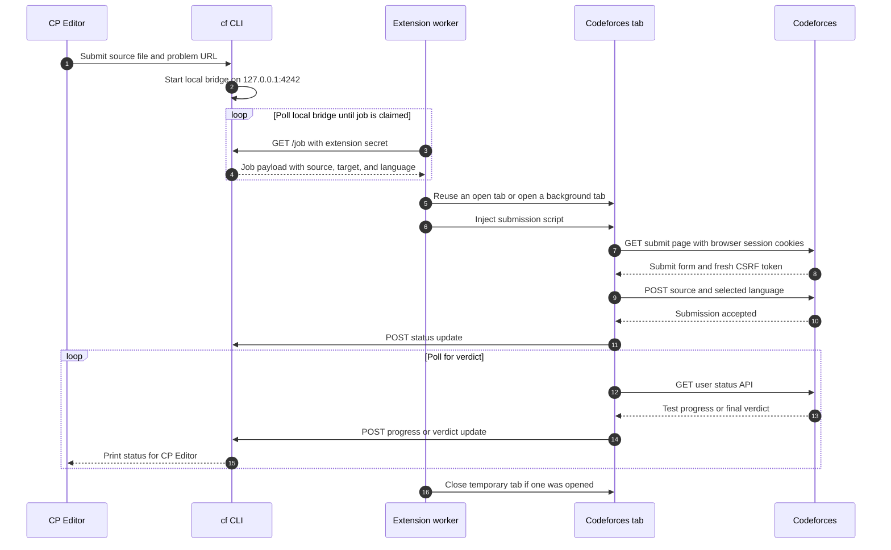

# cf-submit

A lightweight, zero-dependency replacement for `cf-tool` that enables one-click **[CP Editor](https://cpeditor.org)** submissions to Codeforces by bridging your local CLI through your active browser session.

## Why This Exists

The original `xalanq/cf-tool` is archived and regularly fails with `Cannot find csrf` or login rejections due to Codeforces' Cloudflare Managed Challenges, TLS fingerprinting, and dynamic anti-spam tokens (`ftaa` / `bfaa`).

Instead of fighting anti-bot checks with headless HTTP scraping, **cf-submit** routes submissions through your already-authenticated browser session—just like Competitive Companion in reverse.

## Architecture



## Features

- **Bypasses Cloudflare & CSRF Errors:** Executes submissions inside your real browser session with valid `JSESSIONID`, `cf_clearance`, `csrf_token`, `ftaa`, and `bfaa` tokens.
- **Zero Open Tabs Required:** Automatically uses an existing Codeforces tab if open, or opens a temporary background tab for the submission and verdict check, then closes it.
- **Auto-Compiler Detection:** Verifies `programTypeId` against the contest's live compiler dropdown and falls back automatically if a compiler ID changes.
- **Native CP Editor Verdict Colors & Toasts:** The browser extension polls Codeforces' public `user.status` API and sends `status: ...` updates to the CLI for CP Editor's verdict coloring and desktop notifications.
- **Protected Local Bridge:** Job requests require the pinned extension identity and a per-install secret; status updates also require a per-submission token.
- **Zero npm Dependencies:** The CLI uses Node.js built-in modules and the browser extension uses the browser's extension APIs.

## Repository Structure

```text
cf-submit/
├── cli/
│   ├── install.sh       # Builds and installs the native `cf` launcher
│   ├── main.js          # Localhost HTTP bridge and submission CLI
│   └── wrapper.cpp      # Small native launcher for CP Editor
├── extension/
│   ├── manifest.json    # Manifest V3 configuration
│   └── main.js          # Service worker & in-page Codeforces form submitter
├── tests/
│   └── test_extension.mjs # Node.js unit tests for extension tab management
├── .github/workflows/
│   ├── ci.yml             # Source checks and packaged-install smoke test
│   └── release.yml        # Builds the versioned full-project ZIP
└── LICENSE
```

## Installation

### Prerequisites

- **Node.js** and `clang++` or `g++` to build the native launcher
- **Chromium-based browser** (Chrome, Brave, Edge) logged into [Codeforces](https://codeforces.com)

### 1. Download and extract the release

```bash
unzip cf-submit-v1.1.0-linux-x86_64.zip
cd cf-submit-v1.1.0-linux-x86_64
./cli/install.sh
```

Download the ZIP from the [Releases page](https://github.com/28arnab/cf-submit/releases). Keep the extracted folder in place after installation: the native launcher loads the CLI beside itself. Run the installer before loading the extension: it builds the native `cf` launcher and generates `extension/bridge-config.js` with a private per-install bridge secret required by the CLI and extension. To install the command in `/usr/local/bin/cf`, run `sudo ./cli/install.sh`.

### 2. Load the Browser Extension

1. Open `chrome://extensions` (or `brave://extensions` / `edge://extensions`).
2. Enable **Developer mode** in the top-right corner.
3. Click **Load unpacked** and select the `extension` folder inside the extracted release folder.
4. Make sure you are logged into [Codeforces](https://codeforces.com) in your browser.

The extension manifest pins its ID for the local bridge. If you already loaded an older copy, remove it and load this updated folder again after running the installer.

### 3. Configure CP Editor

1. Open **CP Editor → Preferences → Extensions → CF Tool**.
2. Set **CF Tool Path** to `cf` (or the full path printed by the installer, such as `~/.local/bin/cf` or `/usr/local/bin/cf`).
3. Click **Apply** and hit **Submit** on any Codeforces problem!

## Supported Languages (`cli/main.js`)

| Extension | Default `programTypeId` | Language                                              |
| :-------- | :---------------------- | :---------------------------------------------------- |
| `.cpp`    | `89`                    | GNU G++20 64-bit (auto-falls back to active G++20/23) |
| `.py`     | `31`                    | Python 3 (auto-falls back to active Python 3)         |
| `.java`   | `87`                    | Java 21 64-bit                                        |

## Development & Testing

Run the source checks and browser extension tests from the repository root:

```bash
node --check cli/main.js
node --check extension/main.js
node --test tests/test_extension.mjs
```

If contributing, install the `pre-commit` hooks to automatically run formatting and validation checks before committing:

```bash
pre-commit install
```

## License

[MIT](LICENSE)
