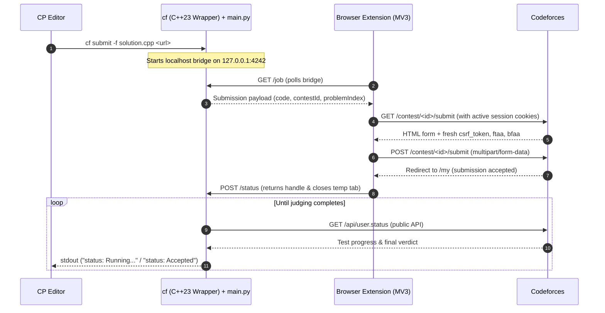

# cf-submit

A lightweight, zero-dependency replacement for `cf-tool` that enables one-click **[CP Editor](https://cpeditor.org)** submissions to Codeforces by bridging your local CLI through your active browser session.

## Why This Exists

The original `xalanq/cf-tool` is archived and regularly fails with `Cannot find csrf` or login rejections due to Codeforces' Cloudflare Managed Challenges, TLS fingerprinting, and dynamic anti-spam tokens (`ftaa` / `bfaa`).

Instead of fighting anti-bot checks with headless HTTP scraping, **cf-submit** routes submissions through your already-authenticated browser session—just like Competitive Companion in reverse.

## Architecture



## Features

- **Bypasses Cloudflare & CSRF Errors:** Executes submissions inside your real browser session with valid `JSESSIONID`, `cf_clearance`, `csrf_token`, `ftaa`, and `bfaa` tokens.
- **Zero Open Tabs Required:** Automatically uses an existing Codeforces tab if open, or silently opens a temporary background tab and closes it immediately after `POST`.
- **Auto-Compiler Detection:** Verifies `programTypeId` against the contest's live compiler dropdown and falls back automatically if a compiler ID changes.
- **Native CP Editor Verdict Colors & Toasts:** Polls Codeforces' public `user.status` API from Python and emits `status: ...` prefixes for green/red highlighting and desktop notifications.
- **Zero External Runtime Dependencies:** Built strictly on Python 3's standard library and C++23 (`std::filesystem`).

## Repository Structure

```text
cf-submit/
├── cli/
│   ├── install.sh       # Compiles wrapper.cpp with clang++ (-std=c++23) and symlinks cf
│   ├── main.py          # Localhost HTTP bridge, URL parser, and verdict poller
│   └── wrapper.cpp      # Native C++23 binary wrapper for CP Editor QProcess checks
├── extension/
│   ├── manifest.json    # Manifest V3 configuration
│   └── main.js          # Service worker & in-page Codeforces form submitter
├── tests/
│   ├── test_cli.py          # Python unittest suite for URL/argument parsing
│   └── test_extension.mjs   # Node.js unit tests for extension tab management
└── .github/workflows/ci.yml # Automated C++23 build & test pipeline
```

## Installation

### Prerequisites

- **Linux** with `clang++` (C++23 support) and `python3`
- **Chromium-based browser** (Chrome, Brave, Edge) logged into [Codeforces](https://codeforces.com)

### 1. Clone & Build the CLI

```bash
git clone https://github.com/28arnab/cf-submit.git
cd cf-submit/cli
./install.sh
```
_(To install system-wide into `/usr/local/bin/cf`, run `sudo ./install.sh`.)_

### 2. Load the Browser Extension

1. Open `chrome://extensions` (or `brave://extensions` / `edge://extensions`).
2. Enable **Developer mode** in the top-right corner.
3. Click **Load unpacked** and select the `cf-submit/extension` folder (or download the pre-packaged `.zip` from [Releases](https://github.com)).
4. Make sure you are logged into [Codeforces](https://codeforces.com) in your browser.

### 3. Configure CP Editor

1. Open **CP Editor → Preferences → Extensions → CF Tool**.
2. Set **CF Tool Path** to `cf` (or the full path printed by `./install.sh`, such as `~/.local/bin/cf` or `/usr/local/bin/cf`).
3. Click **Apply** and hit **Submit** on any Codeforces problem!

## Supported Languages (`cli/main.py`)

| Extension | Default `programTypeId` | Language                                              |
| :-------- | :---------------------- | :---------------------------------------------------- |
| `.cpp`    | `89`                    | GNU G++20 64-bit (auto-falls back to active G++20/23) |
| `.c`      | `43`                    | GNU GCC C11                                           |
| `.py`     | `31`                    | Python 3 (auto-falls back to active Python 3)         |
| `.java`   | `87`                    | Java 21 64-bit                                        |
| `.rs`     | `75`                    | Rust                                                  |

## Development & Testing

Run the unit tests for both the Python CLI and the browser extension from the repository root:

```bash
# Python CLI tests
python3 -m unittest discover -v tests

# Browser extension tests
node --test tests/test_extension.mjs
```

If contributing, install the `pre-commit` hooks to automatically run formatting (`clang-format`, `ruff`) and validation checks before committing:

```bash
pre-commit install
```

## License

[MIT](LICENSE)
